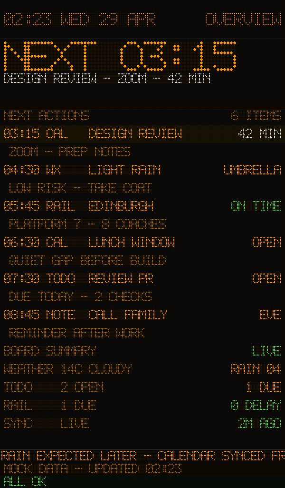
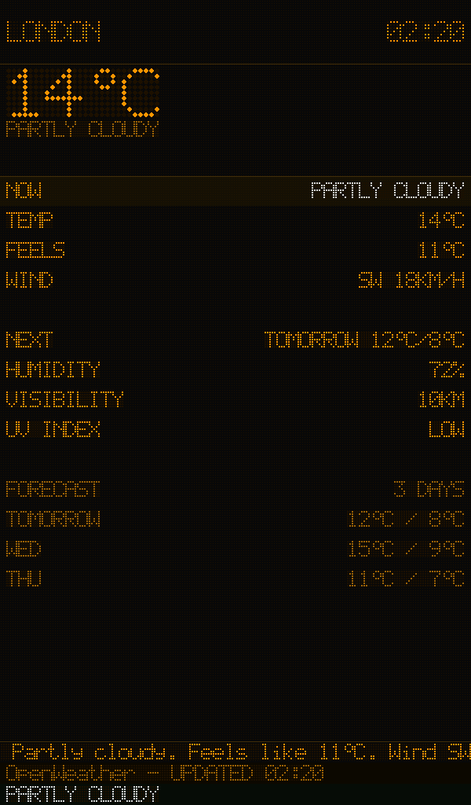

# PiBoard：树莓派复古点阵信息屏

**Retro Dot-Matrix Information Display for Raspberry Pi**

[中文](#中文) | [English](#english)

将天气、个人日历、英国列车动态和自定义文字，显示在一块英式车站风格的复古 LED 点阵屏上。通过手机或电脑上的局域网控制台，即可切换页面、配置数据和调整显示。

Display weather, personal calendars, UK rail updates and custom text on a retro LED dot-matrix screen inspired by British railway departure boards. Switch pages, configure data sources and adjust the display from a phone or computer on your local network.





## 中文

### 项目与版本

项目面向 Raspberry Pi Zero 2W，使用 Python、pygame 和 SDL2 `kmsdrm` 直接驱动屏幕，无需桌面环境或浏览器；也支持在电脑上窗口预览。真实数据需要配置对应来源，演示数据会明确标注。

当前源码版本：`v0.1.2-rc.1`，显示与运行修复候选版。最近正式标签仍为 `v0.1.1`；候选版尚未完成整合后的 Pi 验收，不等于已发布正式版。

### 能展示什么

- Overview：天气、日程、列车状态的综合摘要。
- Train：英国铁路出发板样式；mock 模式明确标为 demo；当前 `main` 默认使用 Huxley2 兼容 live endpoint，并保留原 Huxley2 Azure 地址作为 fallback。
- Weather：无 OpenWeatherMap API Key 时走 Open-Meteo live；有 Key 时保留 OpenWeatherMap 路径。
- Calendar：有 iCal URL 时走日历 live；未配置时显示 mock 日程。
- Custom：手工编辑的自定义看板，不属于 live 数据源。

Web 控制台端口固定为 `8080`，常用检查端点为 `/api/state`、`/api/device-status` 和 `/api/version`。

### 本地运行

在仓库根目录打开终端，然后运行：

```bash
cd piboard
pip install -r requirements.txt
python3 main.py --window
```

打开 `http://localhost:8080` 查看 Web 控制台。

回到仓库根目录运行最小检查（另开终端，或先退出程序）：

```bash
python3 -m compileall -q piboard
python3 tests/smoke_v0_1_1.py
python3 tests/smoke_visual.py
python3 -m unittest discover -s tests -p 'test_*.py'
```

### 部署到 Pi

在仓库根目录使用同步脚本，将占位值替换为自己的 Pi 用户和地址。部署前备份设备上的私有配置；本次文档更新不会自动部署到 Pi。

```bash
piboard/deployment/sync-to-pi.sh 'pi-user@pi-host-or-ip'
```

也可以设置 `PIBOARD_PI_HOST=<pi-user@pi-host-or-ip>` 后运行同一脚本。脚本会同步 `piboard/`，安装 `piboard.service`，并在 Pi 运行目录生成 `BUILD_INFO`。运行时版本可通过：

```bash
curl 'http://<pi-host-or-ip>:8080/api/version'
curl 'http://<pi-host-or-ip>:8080/api/device-status'
```

Pi service 使用 direct `kmsdrm`：

```ini
ExecStart=/usr/bin/python3 /home/<pi-user>/CC-UK-TR/piboard/main.py --portrait --display-rotate 90
Environment=SDL_VIDEODRIVER=kmsdrm
Environment=SDL_AUDIODRIVER=dummy
```

### 数据真实性边界

| 页面 | 数据边界 |
|---|---|
| Overview | 混合摘要；按各来源的配置与缓存结果标注 LIVE / MOCK / WAIT / STALE |
| Train | 默认 mock/demo；配置 `data_source=huxley2` 后走 Huxley2 兼容 live endpoint，BHM 已在 post-v0.1.1 hotfix 中验证 |
| Weather | Open-Meteo live 曾在本地验证，并非本次外部服务复测；使用已保存的位置，OpenWeatherMap 需要用户自己的 API Key |
| Calendar | 默认 mock/demo；配置用户自己的 iCal 订阅后使用该日历；没有公开测试源，不宣称通用 live 验收完成 |
| Custom | 手工内容，不是 live 数据 |

### 验收记录

- `v0.1.2-rc.1` 整理及待验收项：[docs/v0.1.2-rc.1.md](docs/v0.1.2-rc.1.md)
- 点阵字体前后对比：[字体审查记录](docs/font-review-2026-11-11.md)；下载仓库后可直接打开 [交互对比页](piboard/review_artifacts/font-review-2026-11-11/index.html)。GitHub 文件页本身不执行该 HTML。
- [视觉与交互审查](docs/visual-review-2026-11-11.md) / [运行审计与遗留问题](docs/project-audit-2026-11-10.md)
- `v0.1-demo` 历史记录：[docs/v0.1-demo.md](docs/v0.1-demo.md)
- `v0.1.1` 发布验收记录：[docs/v0.1.1.md](docs/v0.1.1.md)

### 安全说明

不要提交 `piboard/data/state.json`、`piboard/BUILD_INFO`、私有 iCal URL、个人日历链接、API token、真实密钥、本机路径、真实 LAN IP 或真实 Pi 主机名。需要配置时从 `piboard/data/state.example.json` 复制到本地运行态。

### 当前限制

- 本候选版不新增页面和数据源；Pi 当前仅验证了显示与字体补丁，整合后的运行修复尚待硬件复测。
- Calendar 默认配置是 mock；私人订阅不会随源码同步。重复事件和跨日事件尚未完整支持。
- Train live 依赖公开 Huxley2 兼容服务可用性；当前默认 endpoint 已切到短期替代服务，并保留原 Azure endpoint 作为 fallback。
- 控制台没有登录保护，只适用于受信任的局域网，不应直接暴露到公网。浏览器定位需要安全访问环境；普通局域网 HTTP 可改用手动城市。
- 写入 API 的统一输入校验、并发设置冲突及 OpenWeatherMap 概览兼容性仍有已知缺口，详见审计记录。
- 运行时横竖屏切换仍需要重启进程。

更多实现细节见 [piboard/README.md](piboard/README.md)。

## English

### Project And Version

PiBoard targets the Raspberry Pi Zero 2W. It renders directly to the screen using Python, pygame and SDL2's `kmsdrm` backend, without a desktop environment or browser on the Pi. A windowed preview is also available on a computer. Live data requires the corresponding sources to be configured; demo data is explicitly labelled.

Current source version: **`v0.1.2-rc.1`**, a release candidate for display and runtime fixes. The latest stable tag remains **`v0.1.1`**. Full acceptance of the integrated candidate on Pi is still pending; this is not a final release.

### What It Displays

- **Overview:** a combined summary of weather, calendar events and rail status.
- **Train:** a UK railway departure-board layout. Mock data is labelled as demo. The live path on `main` defaults to a Huxley2-compatible endpoint, with the original Huxley2 Azure endpoint retained as a fallback.
- **Weather:** uses Open-Meteo when no OpenWeatherMap API key is configured; the optional OpenWeatherMap path remains available with a key.
- **Calendar:** reads the configured iCal subscription; without a URL, it shows mock events.
- **Custom:** a manually edited board, not a live data source.

The web console listens on port **`8080`**. Diagnostic endpoints include `/api/state`, `/api/device-status` and `/api/version`.

### Run Locally

Open a terminal at the repository root, then run:

```bash
cd piboard
pip install -r requirements.txt
python3 main.py --window
```

Open `http://localhost:8080` to use the web console.

Run the minimal checks from the repository root in another terminal, or after stopping the app:

```bash
python3 -m compileall -q piboard
python3 tests/smoke_v0_1_1.py
python3 tests/smoke_visual.py
python3 -m unittest discover -s tests -p 'test_*.py'
```

### Deploy To Pi

Run the sync script from the repository root, replacing the placeholder with your Pi user and address. Back up the device's private configuration first. This documentation update does not deploy anything to the Pi.

```bash
piboard/deployment/sync-to-pi.sh 'pi-user@pi-host-or-ip'
```

Alternatively, set `PIBOARD_PI_HOST=pi-user@pi-host-or-ip` and run the same script without an argument. The script syncs `piboard/`, installs `piboard.service` and generates `BUILD_INFO` in the Pi runtime directory. Read the running version and device status with these endpoints, replacing the host placeholder:

```bash
curl 'http://<pi-host-or-ip>:8080/api/version'
curl 'http://<pi-host-or-ip>:8080/api/device-status'
```

The Pi service uses direct `kmsdrm` rendering:

```ini
ExecStart=/usr/bin/python3 /home/<pi-user>/CC-UK-TR/piboard/main.py --portrait --display-rotate 90
Environment=SDL_VIDEODRIVER=kmsdrm
Environment=SDL_AUDIODRIVER=dummy
```

### Live And Demo Data

| Page | Data boundary |
|---|---|
| Overview | Mixed summary; LIVE / MOCK / WAIT / STALE reflect each configured source and its cached result |
| Train | Mock/demo by default. `data_source=huxley2` selects the Huxley2-compatible live path; BHM was verified during the earlier post-v0.1.1 hotfix |
| Weather | Open-Meteo live was verified locally in an earlier check, not retested for this documentation update. The saved location determines the place; OpenWeatherMap requires your own API key |
| Calendar | Mock/demo by default; a configured iCal subscription uses your calendar. General live acceptance is not claimed without a safe public test feed |
| Custom | Manual content, not live data |

### Acceptance And Review Records

- [v0.1.2-rc.1 candidate and pending checks](docs/v0.1.2-rc.1.md)
- [Font review and before/after evidence](docs/font-review-2026-11-11.md). After downloading the repository, open the [interactive comparison](piboard/review_artifacts/font-review-2026-11-11/index.html) locally; GitHub's file viewer does not execute the HTML.
- [Visual and interaction review](docs/visual-review-2026-11-11.md) / [Runtime audit and known gaps](docs/project-audit-2026-11-10.md)
- [Historical v0.1-demo record](docs/v0.1-demo.md)
- [v0.1.1 release acceptance](docs/v0.1.1.md)

Review records retain their original language; the runtime audit is in Chinese.

### Security

Never commit `piboard/data/state.json`, `piboard/BUILD_INFO`, private iCal URLs, personal calendar links, API tokens, real keys, personal filesystem paths, actual LAN IP addresses or private Pi hostnames. Start your local configuration from `piboard/data/state.example.json`; keep the resulting runtime state private.

### Current Limitations

- This candidate adds no new pages or data-source types. Only the display and font overlays have been verified on Pi; the integrated runtime fixes still require hardware acceptance.
- Calendar defaults to mock data. Private subscriptions are not synced with source code. Recurring and multi-day events are not fully supported.
- Live train data depends on public Huxley2-compatible service availability. The default is a short-term replacement endpoint, with the original Azure endpoint retained as a fallback.
- The console has no authentication and is intended only for a trusted LAN. Do not expose it directly to the public Internet. Browser geolocation requires a secure context; use manual city entry over ordinary LAN HTTP.
- Unified write-API validation, concurrent settings conflicts and OpenWeatherMap overview compatibility have known gaps; see the runtime audit.
- Changing between portrait and landscape still requires a process restart.

For implementation details, see the [technical guide](piboard/README.md), whose main body is in Chinese.
