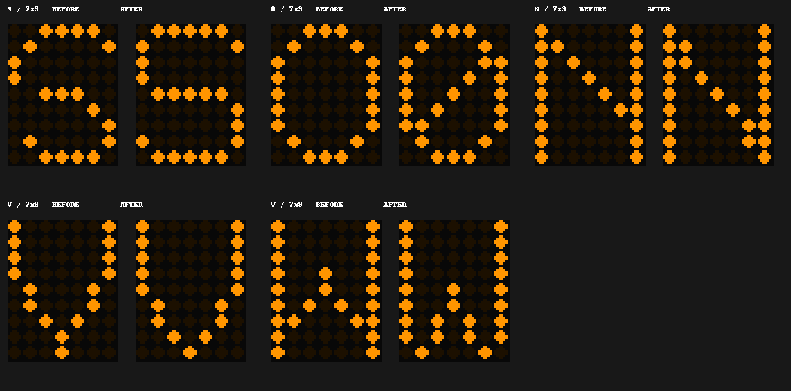

# PiBoard Font And Letter-Spacing Review

Status: human visual review approved and the exact approved font deployed to Pi on 2026-11-12.

## Human Acceptance

- User verdict: “认可修改，通过”.
- Accepted scope: glyph corrections, letter spacing and whole-string appearance shown in the comparison page.
- Accepted `piboard/board/dot_font.py` SHA256: `5c6d79f581932b6b9857fa353fee672a0f59874f1ee4551a7f3be6d7a2df8b05`.
- The current source checksum matches the reviewed artifact's `after_sha256`.
- Subsequent deployment authorization: “通过，准许推到pi”. Only this approved font update was deployed; unrelated uncommitted work was not synchronized.

## Pi Deployment

- Verified deployment time: 2026-11-12 00:33 Asia/Shanghai (`2026-11-11T16:33:08Z`).
- Installed font SHA256 matches the accepted checksum above.
- Runtime marker: base `v0.1.1` / `c636e878eda4`, `source=approved-font-overlay`; this is an approved patch over the existing deployment, not a newly tagged release.
- Pi font tests: 7/7 pass. Pi display geometry/animation tests: 9/9 pass.
- Service: active and enabled. Version/device-status interfaces and the console homepage returned normally; homepage access was also verified from the project computer.
- Private configuration: canonical JSON checksum before and after is identical. The calendar URL, weather location and rail configuration were not overwritten.
- Observation: temperature 47.2°C, throttling `0x0`.
- Pi backup: `.visual-review/2026-11-12-font-deploy/before.tar.gz` inside the deployed project. The backup contains the previous font and version marker.
- Public, redacted deployment evidence: `piboard/review_artifacts/font-review-2026-11-11/deployment.json`. The comparison-page builder displays deployed status only while the current font checksum matches this evidence.
- No system service configuration, route/DNS file, data source, API contract or private state was deployed. Local pre-existing uncommitted work remains preserved.

## Scope

Checked both 5x7 and 7x9 bitmap families, all four raster sizes, the full 95 printable ASCII characters, the degree sign and 12 representative Chinese characters. This covers 108 review entries and 432 size/character combinations. The bundled Chinese font itself is unchanged; this is not a review of every CJK glyph.

The frozen baseline is the actual working-tree font at the start of this pass, including the earlier UI fixes. It is not reconstructed from an older Git commit. Its rendered glyphs and source checksum are retained in `piboard/review_artifacts/font-review-2026-11-11/before.json`; a source backup is in ignored `.visual-review/2026-11-11-fonts/dot_font.before.py`.

## Glyph Findings

| Character | Grid | Problem | Change |
|---|---|---|---|
| S | 7x9 | The upper stroke and lower stroke formed two disconnected groups of adjacent dot positions; the middle and curves were displaced | Connect the middle and give upper/lower curves a consistent outline |
| 0 | 7x9 | Identical to capital O | Add the diagonal already present in the smaller zero |
| N | 5x7 and 7x9 | The diagonal ended in the upper part, leaving the bottom visually like two stems | Distribute the diagonal over the full height |
| V | 7x9 | Two final center rows produced a Y-like tail | End in a single bottom point |
| W | 5x7 and 7x9 | The outline folded back to the outside stems at the bottom | Finish in two clear valleys |

This changes five characters in seven bitmap patterns. Small/medium S, lowercase shapes, glyph-cell dimensions, dot pitch, dot radius and the remaining bitmap designs are preserved.



## Strings And Spacing

Single-glyph inspection is insufficient. The review includes repeated letters, neighboring strokes, time/temperature punctuation, mixed case, station names, status words and Chinese/Latin combinations:

- `VV W`, `VVWW`, `MWMW`, `NNMM`.
- `rn m`, `cl d`, `il li`, `III`, `111`.
- `SSSS`, `S5S5`, `0000`, `O0O0`, `Z2`, `B8`, `I1l`.
- `SHEFFIELD TO SWANSEA`, `WALSALL VIA WORCESTER`, `NEW STREET`.
- `ON TIME 08:35 UK`, `11:11`, `23°C` and mixed Chinese calendar text.

Actual bright-pixel bounds showed only two empty pixel columns between some adjacent small Latin letters. SMALL's additional tracking changes from 1px to 2px, giving three clear pixel columns for that worst case. The other Latin sizes keep their existing spacing.

Unicode fallback can light pixels up to the edges of its square cell. Its adjacent additional gap now has a 3px floor. Measurement and painting share one gap calculation, including mixed-script strings and optional extra character spacing. Existing measured-width truncation and ticker pagination therefore use the same widths as the screen painter. Long text is not squeezed or stretched to compensate for spacing.

Regression checks cover every pair of the non-space printable ASCII set, the degree sign and the 12 Chinese samples at all four sizes, requiring at least three empty columns between their actual bright-pixel bounds. This verifies separation in the raster, not every possible optical effect from a physical panel or camera.

## Human Review Page

Open `piboard/review_artifacts/font-review-2026-11-11/index.html` in a normal desktop browser, or use the local read-only preview at `http://127.0.0.1:8092/` while it is running. The in-app browser uses HTTP because it does not allow direct file URLs. Only the generated review directory is served; no private state or production console is exposed.

The page has three views:

1. **逐字:** original-size and integer-scaled before/after pygame rasters, actual dot-position differences, four size choices, and searchable character groups. It opens on large S.
2. **词句:** custom text and the inspection corpus, with the real before/after letter spacing. Content wider than its viewport scrolls without shrinking the pixels. Characters outside the captured review set are explicitly flagged.
3. **整屏:** a 600x1024 station board rendered twice with the same content and layout, changing only font shapes and spacing. Data is explicitly synthetic. Fixed-size images remain scrollable on narrow screens.

The file is self-contained: raster atlases, before/after board images and metadata are embedded. It has no CDN, external API, user-state access or Pi dependency. The HTML canvas composes the actual exported glyph rasters; it does not substitute a web font for the display font.

## Verification

- The original frozen bitmap tables reproduce three expected failing tests: broken S, indistinguishable 0/O and the V tail. The source files were not reverted during that reproduction.
- Seven glyph/spacing checks pass, including bitmap bounds, connected uppercase strokes, confusable distinctions, fixed glyph dimensions, pair separation and exact text measurement/painting widths.
- The browser checks verify 24 whole-string RGB hashes against real pygame output: before/after, four sizes and three representative Latin/mixed-script strings.
- Browser checks cover desktop 1440px, laptop 1024px and mobile 390px: size/filter/search/zoom controls, focus retention, custom words, unsupported input, native board images and page overflow.
- Existing visual smoke, display geometry/animation regressions, release smoke, audit regressions, compilation and diff checks were rerun after the spacing changes.

Reproduce the review page after edits:

```sh
python3 tests/build_font_review.py
python3 tests/test_font_glyphs.py
python3 tests/smoke_visual.py
python3 tests/test_visual_regressions.py
python3 -m http.server 8092 --bind 127.0.0.1 --directory piboard/review_artifacts/font-review-2026-11-11
```

With Playwright on Node's module search path:

```sh
node tests/font_review_browser.cjs
```

`before.json` is deliberately frozen; the builder refuses to overwrite an existing baseline with a new capture. `changes.json` records exact before/after source hashes and spacing values. Full character contact sheets and responsive screenshots are in ignored `.visual-review/2026-11-11-fonts/`.

## Remaining Review

The glyph and whole-string appearance has passed human review, and the approved version is now running on Pi. Optical blur, panel brightness, viewing distance and physical motion still require direct observation of the panel; the automated checks are offscreen. No new version tag was made, and earlier uncommitted work was preserved. Future font changes require a new review rather than inheriting this checksum-specific approval.
