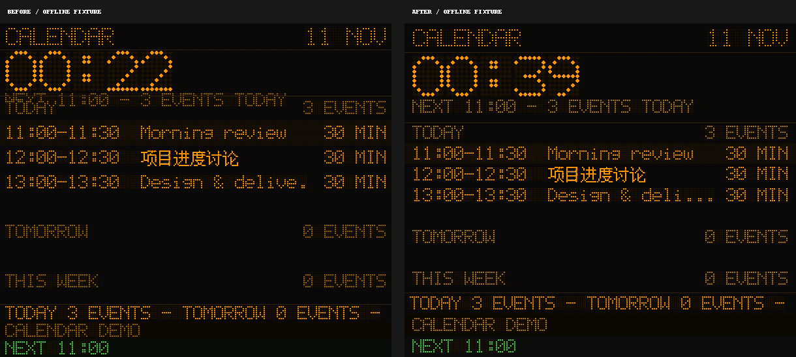
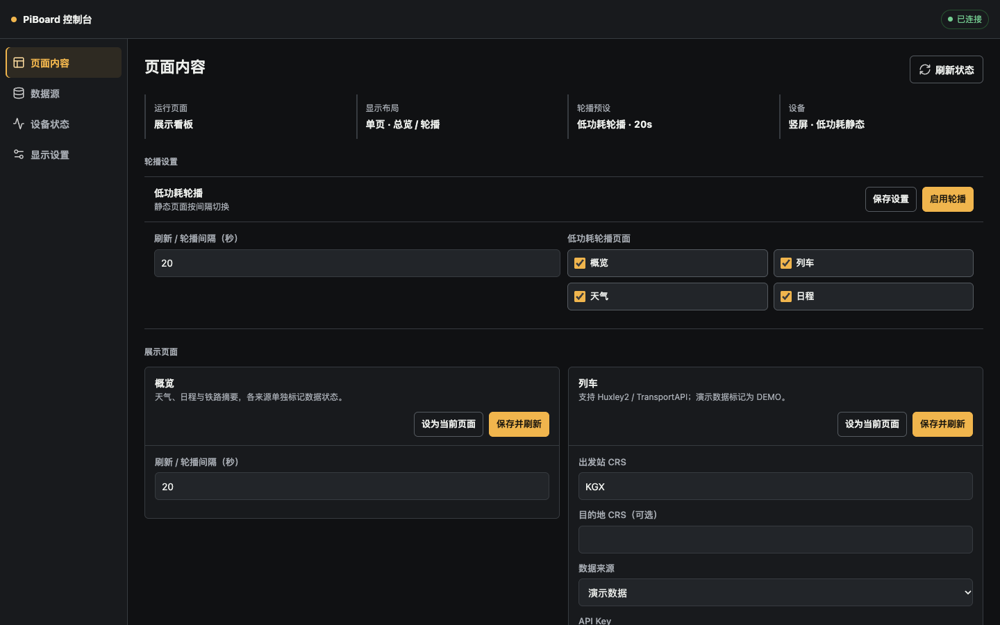
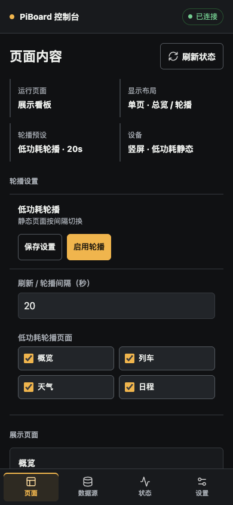
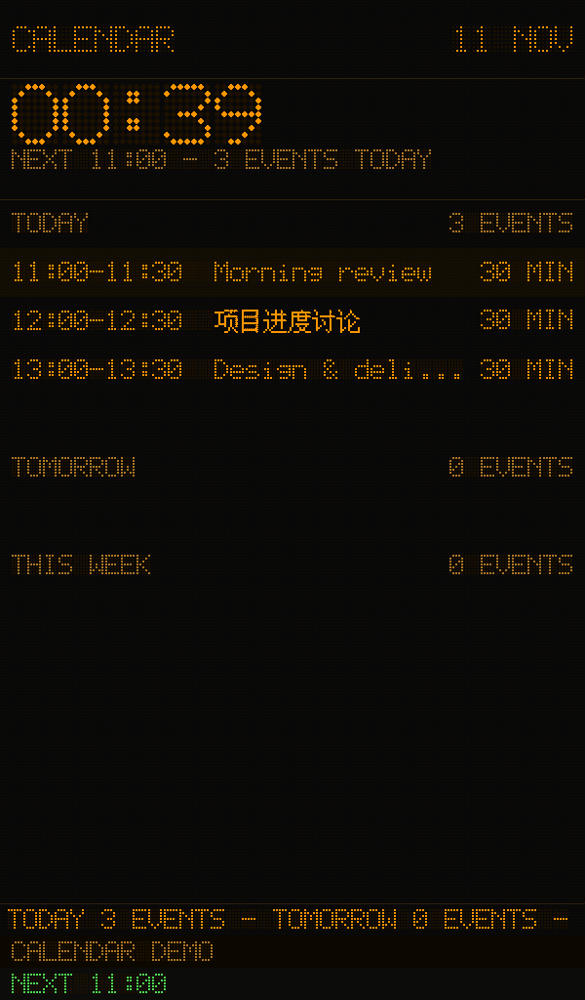

# PiBoard Visual And Usability Review

Date: 2026-11-11 (Asia/Shanghai)

## Scope And Direction

Reviewed the existing five display pages, System Status, single/dual/carousel layouts, amber/green/white themes, and all four console views. The target remains a readable British railway information display: bitmap lettering, dark LED substrate, amber primary content, aligned rows and restrained semantic colors.

Changes are limited to presentation and interaction with existing controls. Providers, live endpoints, credentials, state format and data-refresh behavior are outside this change. Existing uncommitted audit work was preserved; display-related pagination fixes already present in that work were checked alongside this review.

## Findings And Changes

| Area | Finding from this run | Resolution |
|---|---|---|
| Typography | English and Chinese used different top-aligned cell heights; smart punctuation took a full CJK cell | Vertically center original glyphs in a measured line. Normalize common punctuation to the bitmap grid without stretching characters |
| Glyph quality | The small `@` bitmap was malformed | Correct its 5x7 pattern; preserve the remaining established font |
| Hierarchy | Half-height title regions could be shorter than the title plus subtitle | Derive region heights from actual glyph heights and existing font steps; use the same geometry for pagination |
| Legibility | Secondary text and red alerts were faint for small dots | Raise secondary/alert contrast, preserving the amber identity. Give green/white themes matching secondary text |
| Long content | A single dot obscured whether text was truncated; static tickers budgeted characters instead of pixels | Use explicit three-dot truncation and measured-width ticker pages, including Chinese |
| Dense lists | The bottom of a row could be cut off; static mode never advanced overflow rows; changing script could change line height without reconfiguring pages | Show whole rows only. Advance static pages at the existing interval, recalculating on geometry changes without continuous animation |
| Motion | Returning from the last page scrolled backwards through prior pages; transitions blended with old frame contents | Reset directly at wraparound, clear the transition background, reset ticker timing after idle |
| Consistency | System Status used an unrelated system font on a plain black screen | Render its existing runtime status through the shared board renderer |
| Empty content | A deliberately empty Custom page looked like a failed screen | Show a neutral CUSTOM / NO CONTENT state without altering saved content |
| Console color | Blue accents and blue-grey panels did not relate to the device | Use neutral graphite surfaces and restrained amber selection/action accents; retain a normal system font for editing |
| Mobile layout | Summary blocks occupied almost the first screen; headings competed with buttons | Two-column summary at normal mobile widths, wrapped card actions, compact layout selection and clearer form ordering |
| Form usability | Train credentials appeared before the station; Custom title appeared near the bottom; location fields nested a panel inside a card | Order existing fields by task, add color samples, remove nested location framing |
| Click/keyboard | Accordions were clickable divs; some fields/buttons lacked labels; focus and selected app state were weak | Use native accordion buttons with expanded state, current-page/pressed semantics, visible focus and named row actions |
| Feedback | Loading buttons could change width; 3-second error toasts were brief and covered mobile navigation | Preserve button width and original icons, expose busy state, extend errors and move notifications above navigation |
| Navigation | Switching sections reused the old section's scroll offset | Retain each section's own scroll position without clearing unsaved inputs |
| Loading/error | Initial API failure left an empty console after a short toast | Persistent load-failure notice and a reconnect action |
| Binary settings | Animation state used an option menu | Present the same stored boolean with a native switch and clear state text |
| Icons/assets | Mixed geometric symbols and an emoji train looked inconsistent | Use a small locally served Lucide subset with license attribution; no runtime CDN |

## Screen And Flow Coverage

1. **Page content: checked.** Summary, cycle selection, five editable page cards, field order, color samples and current-page indication. Desktop/tablet/mobile screenshots; no horizontal overflow.
2. **Sources: checked.** All five expanded source forms captured on desktop and mobile, expand/collapse, keyboard activation, location fields and password-masked iCal input. No production settings were edited during browser checks.
3. **Device status: checked.** Labels, status colors, metric wrapping and mobile grid. Hardware values in the isolated preview are not Pi acceptance measurements.
4. **Display settings: checked.** Selected app/layout states, brightness percentage, animation switch, orientation and slot fields. Single/dual selection and switch interaction tested using memory-only fixture state.
5. **Save/error/navigation: checked.** Added and edited a row, saved using the existing API, injected a save failure, verified input retention, toast position, loading-button width and section scroll restoration.
6. **Display rendering: checked offscreen.** Overview, demo/live-shaped rail, no services, HTTP 500, Weather, Calendar, mixed Chinese/English, empty Calendar/Custom, loading and dense lists. Four board sizes, three themes, real single/dual/carousel layout classes in static and animated mode.
7. **Motion/accessibility: bounded checks.** Static pagination reaches every page without continuous rendering; ticker idle reset, transition clearing and page wrap have focused regression checks. Browser reduced-motion styling, focus, labels and mobile targets were checked. This is not a screen-reader certification or a physical screen photograph.

## Evidence

All screenshots below use safe offline fixtures. The live-shaped rail specimen exercises the real binding shape but is not proof of a live network response.









Additional accepted samples: `console-error.png`, `train-fixture.png`, `dual-board.png` in the same artifact directory.

Full before/after capture sets, browser profiles and pre-edit backup are in ignored `.visual-review/2026-11-11/`. No private iCal URL or user state is included in tracked evidence. The backup contains the affected files as they existed before this visual change, including earlier uncommitted edits.

## Reproduce

```sh
python3 -m compileall -q piboard tests
python3 tests/smoke_v0_1_1.py
python3 tests/smoke_visual.py
python3 tests/test_visual_regressions.py
python3 tests/test_audit_regressions.py
node --check piboard/web/static/app.js
python3 tests/visual_review.py --out-dir .visual-review/recheck/boards
python3 tests/visual_review.py --serve --port 8081
```

With Playwright available in Node's module search path, a second terminal can run:

```sh
node tests/console_visual.cjs --base http://127.0.0.1:8081 --out-dir .visual-review/recheck/console
```

The browser script uses an isolated project-local profile. Set `PIBOARD_QA_BROWSER` to a local Chrome/Chromium executable if the default macOS Chrome path is unavailable. Browser writes exercise only the in-memory preview. `--capture-only --base http://<pi-host>:8080` captures a deployed console without submitting settings.

## Deployment And Limits

- Pi presentation-only deployment: **verified**, 2026-11-11 00:48 Asia/Shanghai. Existing service is active/enabled, homepage returns HTTP 200. All four deployed console views were captured at 1440, 1024, 768, 390 and 320px widths without horizontal overflow.
- Hardware regression: **9/9 pass** on Python 3.13.5 / pygame 2.6.1 / SDL 2.32.4. Six safe board specimens were generated on the Pi and copied back into the project's ignored evidence directory. These are offscreen renders, not photographs.
- Private state: parsed JSON checksum is identical before and after deployment. No source configuration was submitted by production browser checks. No service-unit, OS, route or DNS file was edited.
- Marker: base `v0.1.1`, commit `c636e878eda4`, plus `source=targeted-presentation-overlay`. Archive SHA256: `dcced293457c0f784fb71ee7489a23db81f2463f7e691a1b8f4834767b83e698`. This is a display patch over the existing deployment, not a newly tagged release or a claim that all local uncommitted audit changes are deployed.
- Pi backup: `.visual-review/2026-11-11/pi-presentation-before.tar.gz` inside the deployed project. Local pre-edit backup: `.visual-review/2026-11-11/backups/presentation-before.tar.gz`.
- Hardware observation: 47.2°C and throttling `0x0` at verification. A warm, offscreen 600x1024 mixed-calendar render averaged 60.74ms over 20 samples. This does not establish 30fps animation performance; the normal static mode retains scheduled low-frequency redraws.
- Local checks: 17 existing audit regressions, 9 display regressions, existing release/visual smoke checks, Python compilation and JavaScript syntax checks pass. Console interaction checks cover keyboard focus, all five expanded forms, app/layout selection, editable row retention, stable loading-button width, mobile notification placement, reduced motion and the animation boolean control. A fresh independent review's two findings were fixed and rechecked.
- Git: the pre-existing uncommitted audit changes remain in the worktree. This visual work is also left uncommitted, with its scope and deployment archive recorded here rather than combining unrelated work into a release commit.
- Physical viewing distance, panel brightness and photographs remain a human hardware check. Rendering fixtures do not prove physical panel quality.
- Long titles and row labels still truncate to protect time/status columns; full supplementary messages use the existing ticker. There is no arbitrary font shrinking or new freeform layout engine.
- The existing seven-row/ nine-row bitmap vocabulary and compact lowercase descenders remain intentional constraints; no replacement font family was introduced.
- No new page, data-source type, plugin system, account flow, router/DNS setting or system service configuration is part of this review.
