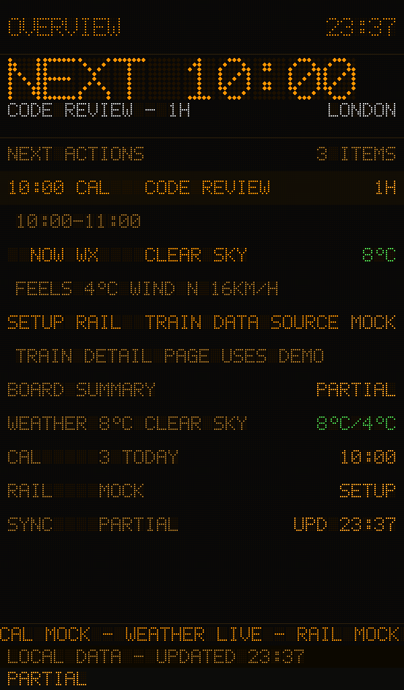
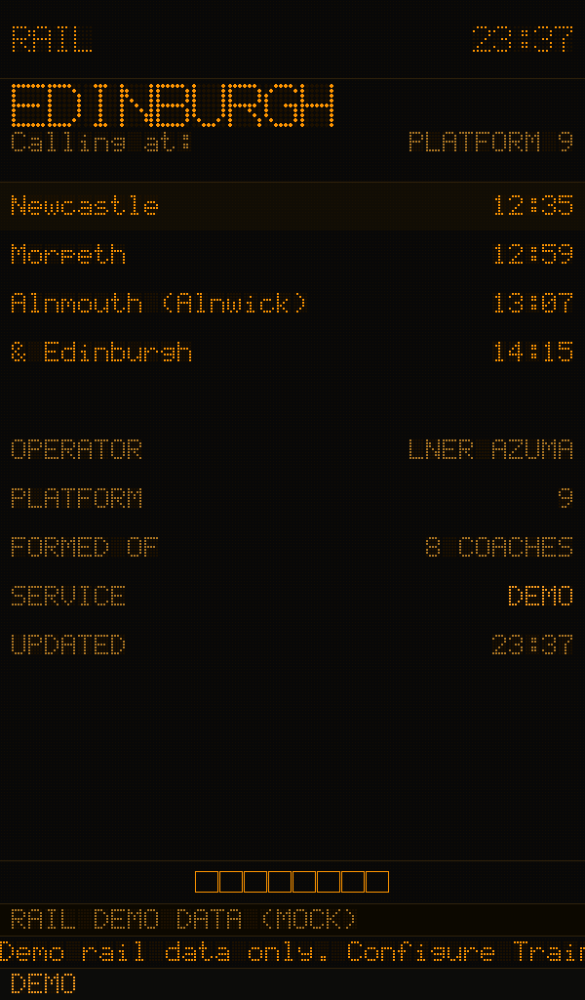
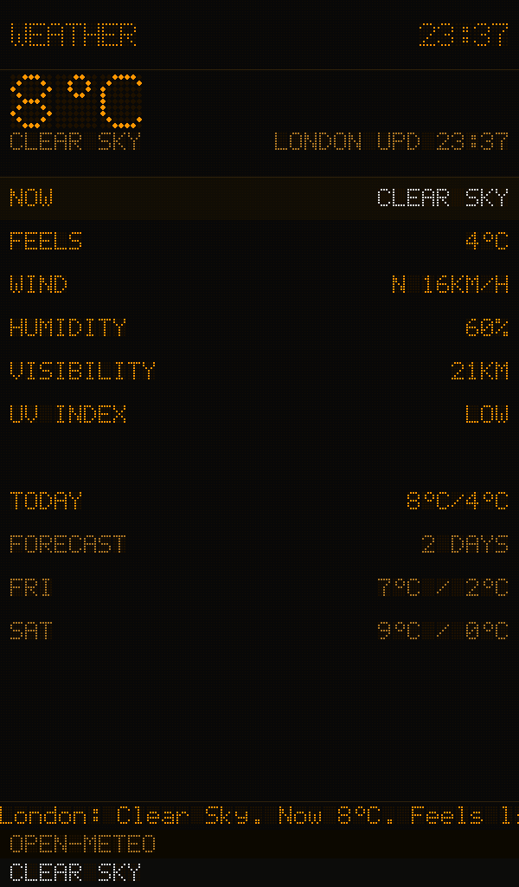
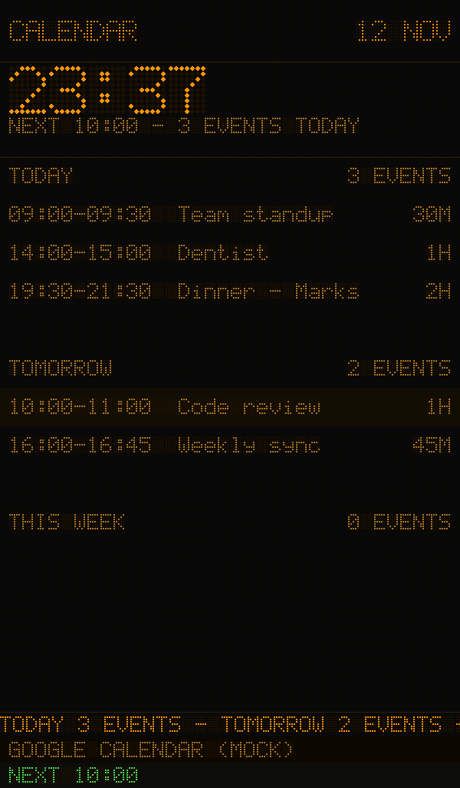
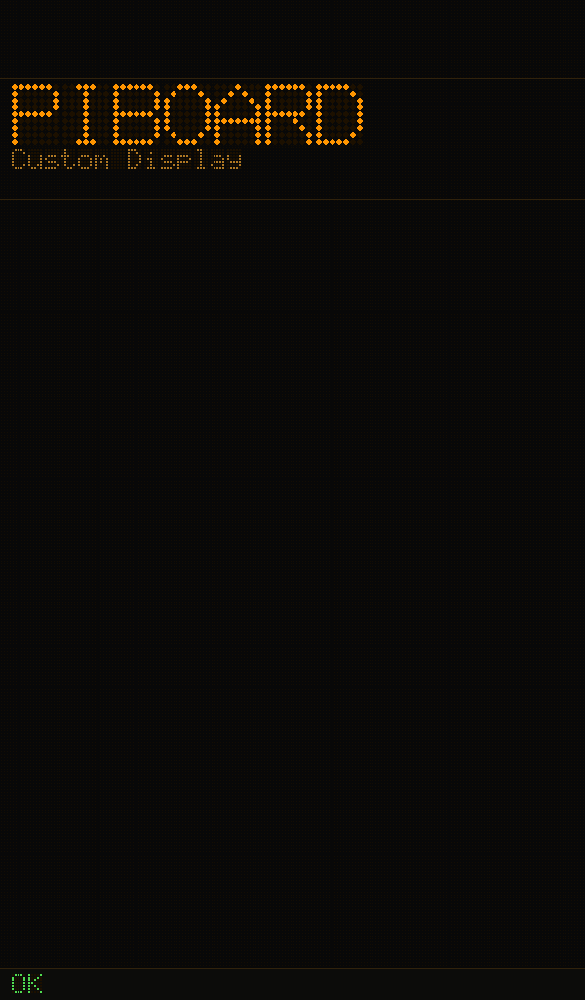

# Pi v0.1.2 Rendering Specimens

Rendered offscreen on the Pi with the integrated runtime at `0b3765b586daa7d6bf7e40199ee7c7360a189df3` on 2026-11-12. The final release retains the same board/font renderer.

These are safe examples, not the user's private calendar/location, screenshots of the running SDL plane or panel photographs. Train and Calendar are mock fixtures; Weather fetches public London Open-Meteo data. Overview explicitly labels the mixed fixture states. Custom is manual text.

| Page | Image |
|---|---|
| Overview |  |
| Train |  |
| Weather |  |
| Calendar |  |
| Custom |  |

Reproduce from the project root on Pi:

```sh
python3 piboard/deployment/export-acceptance-screens.py --out-dir piboard/review_artifacts/pi-acceptance-v0.1.2
```

Real configured source results and service/version checks are separate: see [the release acceptance record](../../../docs/v0.1.2.md) and the final redacted JSON attached to the GitHub Release.
